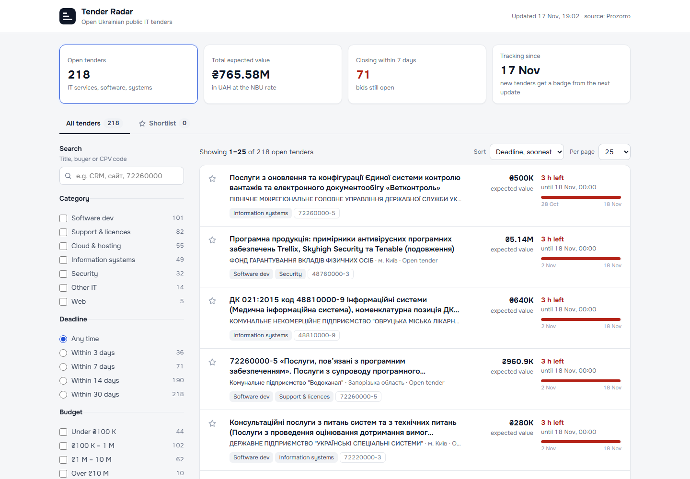
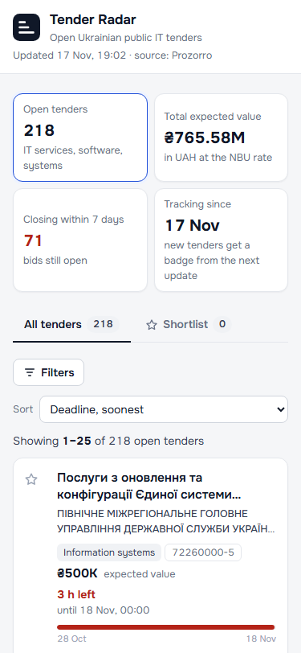

# Tender Radar

A daily radar of open Ukrainian **public IT tenders** from [Prozorro](https://prozorro.gov.ua): software development, websites and web apps, information systems, CRM/ERP, cloud and hosting, cybersecurity, IT support and licences.

It is a static website on GitHub Pages, refreshed every day by GitHub Actions. No server, no database, no API keys.

**Live:** https://ostandrey.github.io/tender-radar/ — refreshed daily at 04:30 UTC by GitHub Actions.





Who it is for: IT companies that want to see new tenders at a glance, and anyone reviewing this repository as an engineering sample.

## How it works

```
                  GitHub Actions, daily 04:30 UTC
 +--------------------------------------------------------------+
 |                                                              |
 |  Prozorro search API ---> collector.py --+                   |
 |   (CPV codes + text)      async httpx,   |                   |
 |   details for NEW only    rate limit,    v                   |
 |                           retries     Tender records         |
 |  NBU exchange rates ----> currency.py -> amount_uah          |
 |                                          |                   |
 |  yesterday's tenders.json (Pages URL) -> store.py: merge,    |
 |                                          dedupe, expire      |
 |                                          |                   |
 |                       site/data/tenders.json + meta.json     |
 |                       site/ (tender_radar/web/*)  --> Pages   |
 +--------------------------------------------------------------+
                              |
                              v
        Browser: vanilla JS loads data/tenders.json, filters client-side
```

The published site is also the database: the next run downloads the currently published `data/tenders.json`, merges today's findings into it and publishes the result again.

## Engineering highlights

- **Async client with rate limiting and retries** (`sources/base.py`). A sliding-window limiter keeps us under Prozorro's 60 requests/minute, honours `x-ratelimit-remaining` and `Retry-After`, and retries timeouts, 429 and 5xx with exponential backoff. Time is injected, so tests run instantly.
- **Failure isolation** (`collector.py`). A failed page or details call is recorded in the run summary (`meta.json`) and the run continues. A run where every query fails exits non-zero, so the deploy is skipped and the previous site stays up.
- **Cheap daily runs.** Details cards are fetched only for tenders not seen before.
- **Idempotent merge** (`store.py`). Merge by tender id keeps `first_seen`, refreshes status/deadline/amount, keeps details already known, drops tenders whose deadline passed more than 2 days ago. Running it twice gives the same file.
- **Currency conversion** (`currency.py`). Amounts in EUR/USD are converted to UAH with the National Bank of Ukraine rate of the run day, with a flagged fallback if the NBU is down.
- **Ukrainian-aware keyword matching** (`textmatch.py`). Word endings are stripped and the і/о alternation is handled, so "розробка" finds "розробки", "розробку". Used for category tags and a 0..100 relevance score.
- **Tests with no network** (46 tests): `httpx.MockTransport` for pagination, retries and rate limiting; fictional JSON fixtures for parsing; store merge/expiry; CLI end to end.
- **CI/CD.** `ci.yml` runs the tests on every push; `update.yml` runs tests, collects, builds and deploys to GitHub Pages.
- **Front end without a build step.** Vanilla HTML/CSS/JS, all tender text rendered with `textContent` (it is untrusted), CSV export neutralises spreadsheet formulas, keyboard accessible, respects `prefers-reduced-motion`.

## Project layout

```
tender_radar/
  config.py          CPV codes, keywords, categories, limits
  sources/base.py    RateLimiter + ApiClient (retries, backoff)
  sources/prozorro.py  Prozorro endpoints and JSON parsing
  collector.py       search, details, normalise, tag, score
  currency.py        NBU rates and conversion
  textmatch.py       Ukrainian stem matching
  models.py          Tender dataclass, URL helpers
  store.py           load previous, merge, expire, write JSON
  site.py            copy web/ into site/
  fixtures.py        offline mode for demos and tests
  web/               index.html, style.css, app.js
tests/               pytest suite, fixtures in tests/fixtures/
.github/workflows/   ci.yml, update.yml
```

## What counts as an IT tender

Prozorro matches CPV filters by exact 10-character code, so `config.py` lists concrete codes: IT services (`72*`: software development, web and internet services, hosting, support, networks, audit) and software packages / information systems (`48*`). Hardware (`30200000` computer equipment) is left out on purpose: the radar is about software and services work. A few text queries (CRM, ERP, кібербезпека, хостинг, веб-сайт) catch tenders filed under a "wrong" CPV; those are kept only if the text also matches at least two keywords.

## The page

Light, document-like list with pagination (25/50/100), filters with live counts (category, deadline, budget, procedure, region), search, sort, a details panel (timeline, bid security, tender documents), a **shortlist** stored in the browser with total value, next deadline and CSV export, and the state in the URL so links and the back button keep your place. Design decisions: [`docs/DESIGN.md`](docs/DESIGN.md).

## Search engines and link previews

`build-site --base-url https://<owner>.github.io/<repo>/` writes canonical and Open Graph tags with absolute URLs, `robots.txt` and `sitemap.xml`; the daily workflow passes the Pages URL. This site shows real public data, so it is open to indexing.

## Run locally

```bash
python -m venv .venv && source .venv/bin/activate     # Windows: .venv\Scripts\activate
pip install -e ".[dev]"

pytest -q                                              # tests, no network
python -m tender_radar collect --max-pages 2           # real run, ~1 minute, writes site/data/
python -m tender_radar build-site                      # copies the UI into site/
python -m http.server -d site 8000                     # open http://localhost:8000
```

Useful options: `collect --previous <path-or-URL>` (merge with an earlier dataset), `--max-pages N` (pages of 20 tenders per query), `--fixture-dir tests/fixtures` (offline demo data).

## Deploy to GitHub Pages

1. Push the repository to GitHub.
2. Settings, Pages, Source: **GitHub Actions**.
3. Run the "Update radar" workflow once (Actions tab, Run workflow). After that it runs daily.

## Data and limits

Data comes from the public Prozorro search at prozorro.gov.ua; this project is not an official Prozorro product. Tender titles are shown as published (Ukrainian). UAH amounts use the NBU rate of the update day. History is limited to tenders that were open when a daily run saw them.
